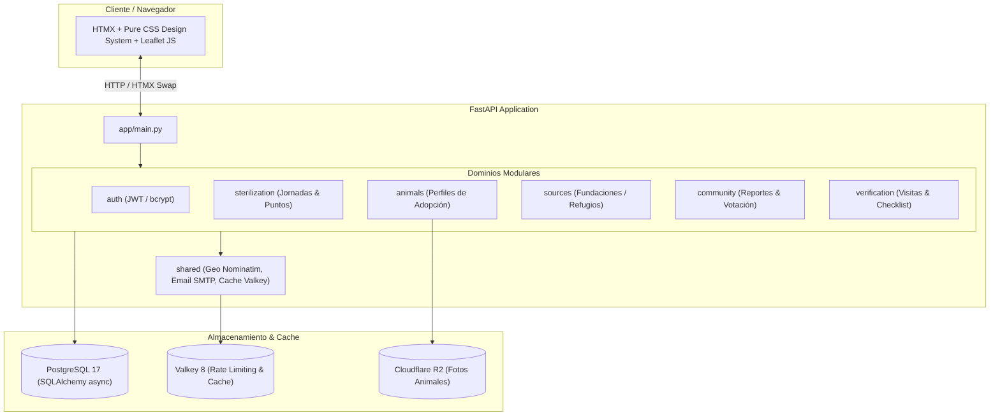

# SOS Animales


**Mapa nacional colaborativo de esterilización, perfiles de animales y verificación de fundaciones en Colombia.**

## Propósito

SOS Animales es una plataforma open data que conecta ciudadanos, fundaciones y veterinarios para:
- Localizar jornadas de esterilización y puntos fijos en toda Colombia.
- Dar visibilidad a animales en adopción con perfiles completos.
- Verificar fundaciones y refugios mediante un proceso estructurado de dos niveles.

**Gobernanza de Acceso y Verificación:**
En esta Fase 1 (MVP), la plataforma no requiere registro previo de cuentas de usuario:
- **Jornadas y Auditorías Oficiales:** Las jornadas de esterilización (`POST /sterilization/new`), puntos fijos y visitas veterinarias requieren autenticación administrativa centralizada (`/auth/login`) para garantizar la veracidad de los eventos oficiales.
- **Adopciones y Registro Comunitario:** Las fundaciones pueden auto-registrarse (`POST /sources/register`, quedando en estado `pending` hasta ser auditadas) y los rescatistas pueden publicar animales en adopción (`POST /animals/`), recibiendo un PIN criptográfico de 4 dígitos en su correo para gestionar el estado del animal sin necesidad de contraseñas ni perfiles permanentes.
- **Interacción Ciudadana:** La comunidad interactúa libremente consultando mapas, reportando novedades con PIN y validando información mediante votaciones protegidas por rate limiting en Valkey.

## Arquitectura del Sistema



## Stack Tecnológico

| Capa | Tecnología |
|------|-----------|
| Backend | FastAPI + SQLAlchemy async (`asyncpg`) |
| Base de datos | PostgreSQL 17 (exclusivamente PostgreSQL con `asyncpg`) |
| Frontend | HTMX + Pure CSS3 (`sos-animales.css`) + Jinja2 (cero build step JS) |
| Caché & Rate Limiting | Valkey 8 (compatible con Redis) |
| Geocoding & Mapas | Leaflet JS + OpenStreetMap / Nominatim |
| Almacenamiento OCI | Cloudflare R2 (`boto3`) |
| Package Manager | `uv` (exclusivo, cero `pip`/`npm`) |
| Auth | JWT (`PyJWT`) + `bcrypt` + `httpOnly` secure cookies |
| Automatización | `Makefile` + Docker Compose |

## Cómo correr localmente

El proyecto incluye un `Makefile` completo para facilitar la operación:

### Opción A: Desarrollo Local con Python y `uv` (Recomendado)

```bash
# 1. Clonar el repositorio y sincronizar entorno
git clone https://github.com/tu-usuario/sos-animales.git
cd sos-animales
uv sync

# 2. Configurar variables de entorno
cp .env.example .env
# Generar hash de admin si deseas ingresar al panel:
uv run python scripts/hash_admin.py

# 3. Levantar servicios de soporte (PostgreSQL en 5433 y Valkey en 6379)
docker compose up -d db valkey

# 4. Aplicar migraciones y seed inicial
make migrate
uv run python -m seed

# 5. Iniciar servidor FastAPI con hot-reload en puerto 8000
make dev
```

### Opción B: Ejecución 100% Contenedorizada

```bash
# Construir y levantar toda la pila (web + db + valkey)
make up

# Aplicar migraciones y seed inicial en el contenedor web
docker compose exec web alembic upgrade head
docker compose exec web python -m seed

# Ver logs en vivo
make logs
```

### Control de Calidad y Tests

```bash
# Ejecutar suite completa (lint, formato, chequeo estricto de tipos y tests)
make check
```

### Seed de datos

El proyecto incluye un sistema de seed que precarga desde archivos JSON en `data/colombia/`:

- **33 departamentos** y **1123 municipios** de Colombia.
- **Datos demo**: campañas de esterilización, fuentes y visitas de verificación.

Todos los seeds son idempotentes — se pueden ejecutar múltiples veces sin duplicar datos.

Para refrescar los datos geográficos desde la API abierta de Colombia (`api-colombia.com`):

```bash
uv run python scripts/fetch_colombia_data.py
```

Luego ejecuta `uv run python -m seed` para cargarlos.

### Administración

El panel de administración está en `/admin/`. Para acceder:

1. Andá a `/auth/login` e ingresá la contraseña del admin.
2. La sesión usa un JWT almacenado en cookie httpOnly.
3. Desde el panel ves estadísticas de la base de datos (campañas, animales, fuentes, puntos fijos).

**Configuración necesaria en `.env`:**

```env
ADMIN_PASSWORD_HASH=<hash_bcrypt_de_la_contraseña>
JWT_SECRET=<clave_secreta_para_firmar_tokens>
JWT_EXPIRE_MINUTES=60
```

El endpoint de login tiene rate limiting: máximo 5 intentos por minuto por IP (respaldado por Valkey).

## Arquitectura

Por dominios (`domains/`), cada uno con su propio `models.py`, `schemas.py`, `tools.py` y `router.py`:

| Dominio | Responsabilidad |
|---------|----------------|
| `auth` | Autenticación JWT, panel admin, rate limiting |
| `sterilization` | Jornadas y puntos fijos de esterilización |
| `sources` | Fundaciones/refugios con estado pending/verified |
| `verification` | Proceso de verificación: requests, checklist, visits |
| `animals` | Perfiles de animales en adopción |
| `community` | Actualizaciones comunitarias con PIN + votación |

## Gobernanza del dato

- **Política de frescura**: 5 días sin confirmación → dato marcado como no confirmado (visible con advertencia).
- **Verificación de dos niveles**: presencial (radio ≤ 2h desde Bogotá) o remota (aliados virtuales), siempre con veterinario.
- **Conflicto comunidad vs. oficial**: se necesita un mínimo de votantes (configurable) para que la comunidad sobreescriba el estado oficial.
- **Sin gestión de dinero, registro público de usuarios, ni chat.**

## Licencia

**AGPL-3.0** — ver [LICENSE](LICENSE). Si alguien usa este código para un servicio web, debe publicar el código fuente de su versión modificada.

## Ver más

- [ROADMAP.md](ROADMAP.md) — alcance completo v1 y plan de fases.
- [CONTRIBUTING.md](CONTRIBUTING.md) — cómo contribuir.
- [CODE_OF_CONDUCT.md](CODE_OF_CONDUCT.md) — código de conducta.
- [SECURITY.md](SECURITY.md) — reportar vulnerabilidades.
